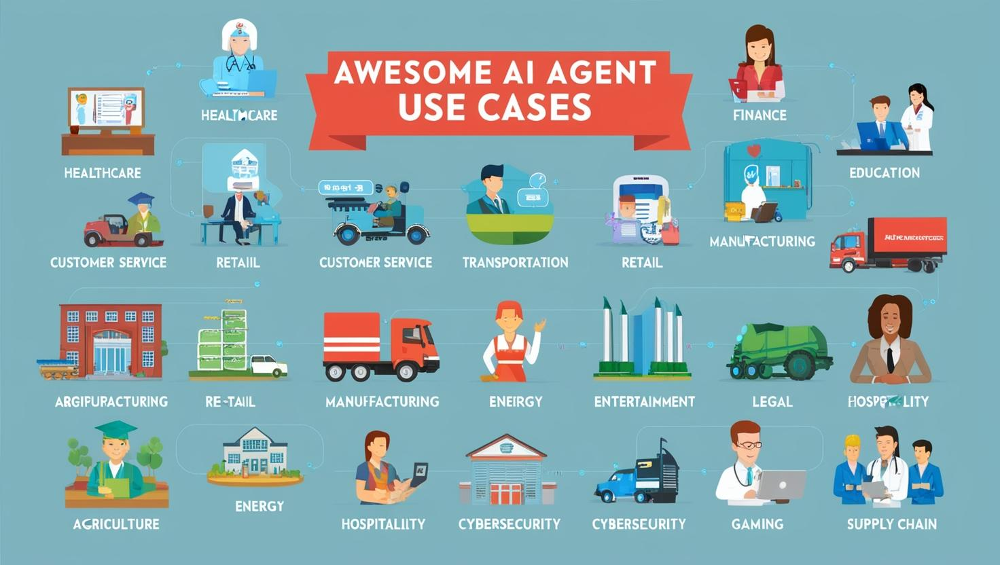

# 500+ AI Agent Projects & Use Cases

<div align="center">

[](https://github.com/ashishpatel26/500-AI-Agents-Projects/stargazers)
[](https://github.com/ashishpatel26/500-AI-Agents-Projects/network/members)
[](https://github.com/ashishpatel26/500-AI-Agents-Projects/graphs/contributors)
[](CONTRIBUTION.md)
[](LICENSE)
[](https://github.com/ashishpatel26/500-AI-Agents-Projects/commits/main)

**The most comprehensive collection of AI agent projects, use cases, and working implementations.**

[🚀 Quick Start](#-quick-start) • [🗺️ Browse Agents](#-browse-by-framework) • [🏭 By Industry](#-industry-use-cases) • [🤝 Contribute](#-contributing) • [📊 Frameworks Compared](#-framework-comparison)

</div>

---



## What is this?

A curated collection of **500+ AI agent projects** — production examples, tutorials, and working code spanning every major framework (LangGraph, CrewAI, AutoGen, Agno) and industry (Healthcare, Finance, Education, Cybersecurity, and more).

**Who it's for:**
- 🧑‍💻 **Developers** building their first or next AI agent
- 🔬 **Researchers** surveying the agent landscape
- 🏢 **Teams** evaluating frameworks for production use
- 🎓 **Students** learning agent architectures from real examples

---

## ⚡ Quick Start

Pick a framework and run an agent in under 5 minutes:

```bash
# Clone the repo
git clone https://github.com/ashishpatel26/500-AI-Agents-Projects.git
cd 500-AI-Agents-Projects

# Run any agent from the agents/ directory
cd agents/01-web-research-agent
pip install -r requirements.txt
cp .env.example .env        # add your API key
python agent.py
```

> All agents in `agents/` are self-contained with their own `requirements.txt` and `.env.example`. No monorepo setup needed.

---

## 🗺️ Navigation Guide

| I want to... | Go to |
|---|---|
| Run a working agent right now | [`agents/`](agents/) |
| Browse by AI framework | [Framework-wise Use Cases](#-browse-by-framework) |
| Browse by industry | [Industry Use Cases](#-industry-use-cases) |
| Understand which framework to use | [Framework Comparison](#-framework-comparison) |
| Add my own agent | [Contributing](CONTRIBUTION.md) |
| Learn with a course | [`crewai_mcp_course/`](crewai_mcp_course/) |

