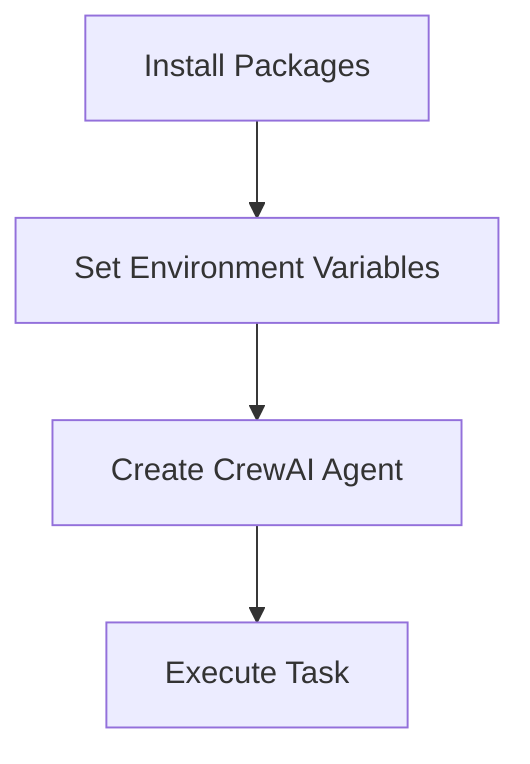
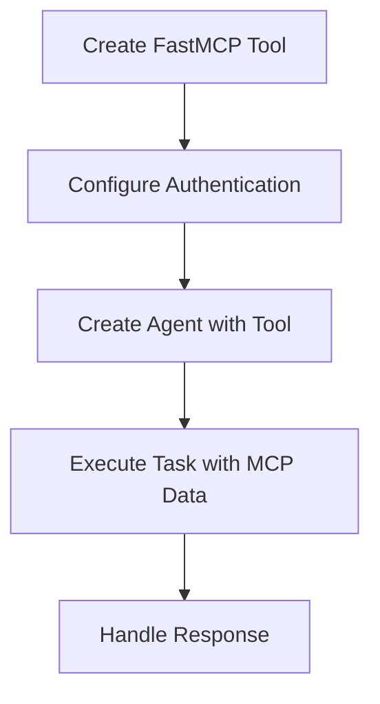

# CrewAI with FastMCP Server Integration Course

This course teaches beginners how to use CrewAI with FastMCP server access through step-by-step programming examples.

## Course Overview

This course is designed for beginner developers with basic Python knowledge who want to learn how to integrate CrewAI agents with FastMCP servers. The course covers fundamental concepts, practical implementation, and advanced patterns for building intelligent agent workflows.

## Lessons

### Lesson 1: Setting up CrewAI with MCP Server Access
- Install required packages
- Set up environment variables
- Create a basic CrewAI agent
- Execute simple tasks

### Lesson 2: Integrating MCP Server with CrewAI
- Create custom tools for MCP server access
- Configure authentication and connection settings
- Use MCP server data in agent tasks
- Handle errors and exceptions

