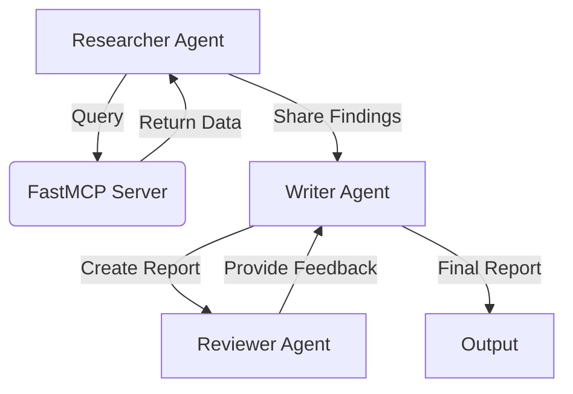

### Lesson 3: Advanced CrewAI Patterns with MCP Server
- Implement multi-agent workflows
- Use hierarchical processes
- Share data between agents through the MCP server
- Store and retrieve research findings
- Implement quality assurance processes



## Getting Started

### Using pip (traditional method)

1. Install the required packages for the lesson you want to run:
```bash
pip install -r lesson_01/requirements.txt
pip install -r lesson_02/requirements.txt
pip install -r lesson_03/requirements.txt
```

2. Set up your environment variables:
```bash
export OPENAI_API_KEY=your-openai-api-key
export MCP_SERVER_URL=http://localhost:8000
```

3. Run the examples:
